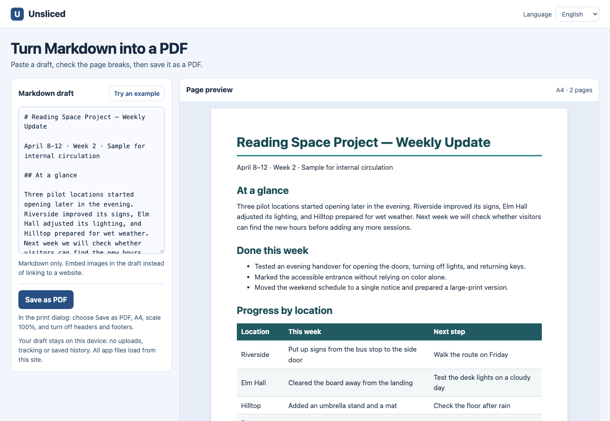

# Unsliced Web

**[Open Unsliced Web](https://harrythex42.github.io/unsliced-web/) · [简体中文](README.zh-CN.md)**

1. Open the link in Chrome or Edge.
2. Paste your Markdown, or select **Try an example**. The page preview updates automatically.
3. Select **Save as PDF**. In the print dialog, choose **Save as PDF**, A4, 100% scale, and turn off headers and footers.

## What it does

- Previews page breaks before printing. Long tables split between complete rows and repeat their headers.
- Produces real text you can search and copy, including Chinese.
- Offers English and Simplified Chinese interfaces, with no account required.

## Limits and privacy

Chrome and Edge are recommended. Other browsers can open the site, but their print results may differ. The site accepts Markdown, not raw HTML; images must be embedded rather than linked to external sites. Mobile printing is not guaranteed.

Your draft is processed on your device. It is not uploaded, tracked, or saved by the app. The site loads its own assets, including Chinese fonts only when needed.

## Project links

The pagination engine and the MCP tool live in [the main Unsliced project](https://github.com/harrythex42/Unsliced). For local builds, acceptance checks, and the steps to upgrade the fixed engine version, see [Development](docs/development.md).

[MIT license and BreakFlow copyright](LICENSE) · [Font license (OFL)](OFL.txt)
