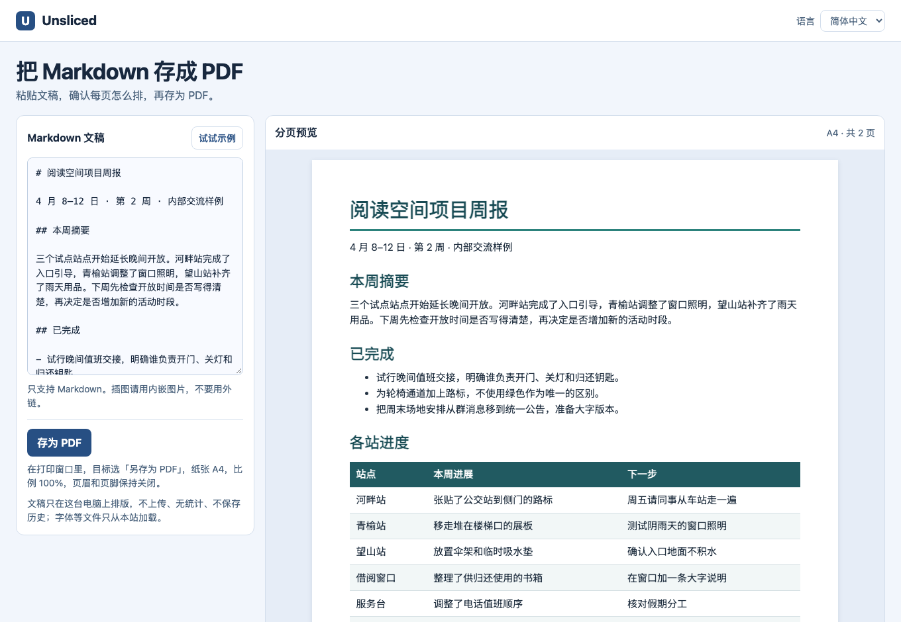

# Unsliced 网页版

**[打开 Unsliced 网页版](https://harrythex42.github.io/unsliced-web/) · [English](README.md)**

1. 用 Chrome 或 Edge 打开上面的链接。
2. 粘贴 Markdown，或点「试试示例」。页面会自动更新分页预览。
3. 点「存为 PDF」。在打印窗口选择「另存为 PDF」、A4、比例 100%，并关闭页眉和页脚。

## 特点

- 打印前可以查看每页怎么排。长表只在完整的行之间分页，续页重复表头。
- PDF 保存的是真实文字，中文也能搜索和复制。
- 界面支持简体中文和英文，不需要登录。

## 限制和隐私

推荐 Chrome 或 Edge。其他浏览器可以打开，但打印效果可能不同；手机打印不作保证。只支持 Markdown，不支持直接贴入 HTML；插图要嵌到文稿里，不能用外站链接。

文稿在你自己的电脑上处理，不上传、不统计、不保存历史。字体等文件只从本站加载，只有文稿需要时才下载中文字体。

## 项目链接

分页程序和 MCP 版都在 [Unsliced 主项目](https://github.com/harrythex42/Unsliced)。本地构建、验收和升级固定分页版本的方法，见[开发说明](docs/development.md)。

[MIT 许可证和 BreakFlow 版权声明](LICENSE) · [字体许可证（OFL）](OFL.txt)
